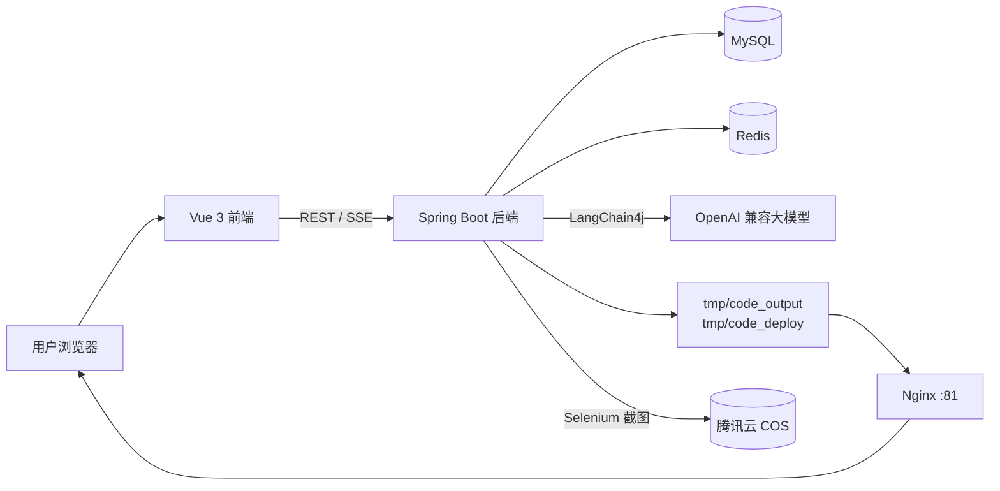
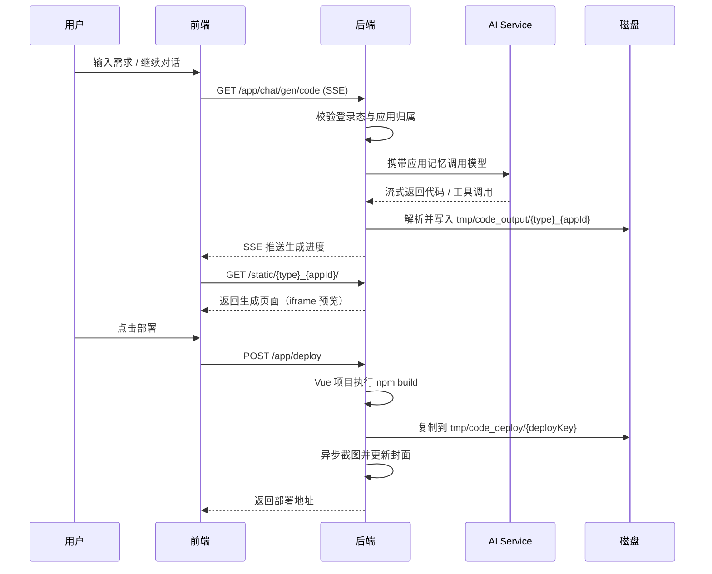
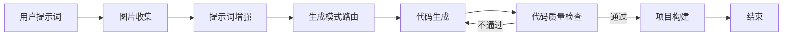

<div align="center">

# ZeroCraft

**用一句话，生成一个可预览、可部署的 Web 应用**

AI 全栈应用生成平台 · Spring Boot 3 + Vue 3 + LangChain4j + LangGraph4j

[](https://openjdk.org/)
[](https://spring.io/projects/spring-boot)
[](https://vuejs.org/)
[](https://docs.langchain4j.dev/)
[]()

[功能特性](#功能特性) · [技术栈](#技术栈) · [系统架构](#系统架构) · [快速开始](#快速开始) · [API](#api-一览) · [微服务版](#微服务版)

</div>

---

## 项目简介

ZeroCraft 是一个 **AI 驱动的 Web 应用生成平台**。用户只需要用自然语言描述想要的网站，平台就会：

1. 自动判断适合的生成模式（原生 HTML / 多文件 / Vue 工程）；
2. 通过大模型流式生成完整代码；
3. 实时写入本地项目目录，并在右侧 iframe 中预览；
4. 支持继续对话迭代、下载源码、一键部署、自动截图生成应用封面。

项目同时包含两套后端实现：

| 版本 | 位置 | 状态 |
| --- | --- | --- |
| 单体版 | 仓库根目录 `src/` | ✅ 功能完整，推荐体验 |
| 微服务版 | `ZeroCraft-microservice/` | 🚧 基于 Nacos + Dubbo 的拆分实践，持续完善中 |

前端位于 `frontend/`，基于 Vue 3 + TypeScript + Ant Design Vue。

## 功能特性

### 用户侧

- 💬 **对话式生成**：输入一句话即可创建网站，支持多轮对话增量修改
- ⚡ **流式输出**：SSE 实时返回 AI 生成内容、工具调用过程与代码进度
- 👀 **实时预览**：生成过程中即可在 iframe 中查看页面效果，支持可视化编辑
- 🧠 **应用级记忆**：每个应用独立对话记忆，Redis + MySQL 双重持久化
- 📦 **源码下载**：一键打包下载生成的项目源码
- 🚀 **一键部署**：自动构建并发布到 `deployKey` 对应的访问地址
- 🖼️ **自动封面**：部署后异步截图并上传对象存储，作为应用封面
- 🔍 **应用广场**：浏览精选应用、查看应用详情

### 管理侧

- 👤 用户管理、应用管理、对话记录管理
- ⭐ 设置精选应用、调整优先级
- 🗑️ 管理员删除 / 编辑任意应用
- 📊 AI 调用指标、Token 消耗、响应耗时监控

### AI 能力

- **三种生成模式**：`html`、`multi_file`、`vue_project`
- **智能路由**：由 LLM 根据提示词自动选择生成模式
- **Agent 工具调用**：文件读取、写入、修改、删除、目录浏览、退出工具
- **提示词护栏**：输入安全校验 + 输出重试护栏
- **生成工作流**：LangGraph4j 编排「图片收集 → 提示词增强 → 路由 → 代码生成 → 质检 → 构建」，质检失败可自动重试
- **模型兼容**：任意 OpenAI 兼容接口均可接入（示例使用 DeepSeek 模型）

## 技术栈

| 分类 | 技术 |
| --- | --- |
| 语言 / 运行时 | Java 21（虚拟线程）、TypeScript、Node.js 20+ |
| 后端框架 | Spring Boot 3.5、Spring Web / WebFlux、Spring Session |
| AI | LangChain4j 1.12、LangGraph4j 1.6、OpenAI 兼容模型、DashScope SDK |
| 数据访问 | MyBatis-Flex 1.11、MySQL 8、HikariCP |
| 缓存 / 会话 | Redis、Redisson、Caffeine |
| 前端 | Vue 3.5、Vite 7、Ant Design Vue 4、Pinia、Vue Router 4、Axios |
| 内容渲染 | markdown-it、highlight.js |
| 截图 | Selenium 4、WebDriverManager、Chrome |
| 对象存储 | 腾讯云 COS |
| 接口文档 | Knife4j / OpenAPI 3 |
| 可观测性 | Spring Boot Actuator、Micrometer、Prometheus |
| 微服务 | Nacos、Dubbo 3.3、Spring Cloud Alibaba |

## 系统架构



### 代码生成流程



### LangGraph4j 工作流



## 目录结构

```text
ZeroCraft
├─ src/main/java/com/pp/zerocraft
│  ├─ ai/                 # AI Service、工具、护栏、消息模型
│  ├─ core/               # 代码生成门面、解析器、保存器、Vue 构建
│  ├─ langgraph4j/        # LangGraph4j 代码生成工作流与节点
│  ├─ controller/         # REST / SSE 接口
│  ├─ service/            # 用户、应用、对话、截图、下载等业务
│  ├─ config/             # AI、Redis、COS、CORS、缓存配置
│  ├─ monitor/            # AI 指标采集与监控监听器
│  ├─ ratelimit/          # Redisson 分布式限流
│  ├─ mapper/             # MyBatis-Flex Mapper
│  └─ model/              # entity / dto / vo / enum
├─ src/main/resources
│  ├─ prompt/             # 各生成模式的系统提示词
│  ├─ mapper/             # MyBatis XML
│  ├─ application.yml     # 主配置
│  └─ application-local.yml # 本地私密配置（Git 忽略）
├─ frontend/              # Vue 3 前端
├─ ZeroCraft-microservice/ # Nacos + Dubbo 微服务版
├─ tmp/                   # 生成与部署产物（Git 忽略）
└─ pom.xml
```

## 快速开始

### 环境要求

| 依赖 | 版本 / 说明 |
| --- | --- |
| JDK | 21+ |
| Maven | 3.9+（或直接使用 `mvnw`） |
| Node.js | 20+，部署 Vue 项目时需要可用的 `npm` |
| MySQL | 8.0+ |
| Redis | 6.0+ |
| Chrome | 自动截图需要（可选） |
| Nacos | 仅微服务版需要 |

### 1. 克隆项目

```bash
git clone https://github.com/ppIsCoding/ZeroCraft.git
cd ZeroCraft
```

### 2. 初始化数据库

创建数据库并执行以下 DDL：

```sql
CREATE DATABASE IF NOT EXISTS `zerocraft`
  DEFAULT CHARACTER SET utf8mb4
  COLLATE utf8mb4_unicode_ci;

USE `zerocraft`;

CREATE TABLE IF NOT EXISTS `user` (
  `id`           bigint       NOT NULL COMMENT '雪花 ID',
  `userAccount`  varchar(256) NOT NULL COMMENT '账号',
  `userPassword` varchar(512) NOT NULL COMMENT '密码',
  `userName`     varchar(256) DEFAULT NULL COMMENT '昵称',
  `userAvatar`   varchar(1024) DEFAULT NULL COMMENT '头像',
  `userProfile`  varchar(512) DEFAULT NULL COMMENT '简介',
  `userRole`     varchar(64)  NOT NULL DEFAULT 'user' COMMENT '角色：user/admin',
  `editTime`     datetime     DEFAULT NULL,
  `createTime`   datetime     DEFAULT CURRENT_TIMESTAMP,
  `updateTime`   datetime     DEFAULT CURRENT_TIMESTAMP ON UPDATE CURRENT_TIMESTAMP,
  `isDelete`     tinyint      NOT NULL DEFAULT 0,
  PRIMARY KEY (`id`),
  UNIQUE KEY `uk_userAccount` (`userAccount`)
) ENGINE = InnoDB DEFAULT CHARSET = utf8mb4 COMMENT = '用户';

CREATE TABLE IF NOT EXISTS `app` (
  `id`           bigint       NOT NULL COMMENT '雪花 ID',
  `appName`      varchar(256) DEFAULT NULL COMMENT '应用名称',
  `cover`        varchar(1024) DEFAULT NULL COMMENT '封面地址',
  `initPrompt`   text COMMENT '初始提示词',
  `codeGenType`  varchar(64)  DEFAULT NULL COMMENT 'html/multi_file/vue_project',
  `deployKey`    varchar(64)  DEFAULT NULL COMMENT '部署标识',
  `deployedTime` datetime     DEFAULT NULL COMMENT '部署时间',
  `priority`     int          NOT NULL DEFAULT 0 COMMENT '优先级，99 为精选',
  `userId`       bigint       NOT NULL COMMENT '创建用户 ID',
  `editTime`     datetime     DEFAULT NULL,
  `createTime`   datetime     DEFAULT CURRENT_TIMESTAMP,
  `updateTime`   datetime     DEFAULT CURRENT_TIMESTAMP ON UPDATE CURRENT_TIMESTAMP,
  `isDelete`     tinyint      NOT NULL DEFAULT 0,
  PRIMARY KEY (`id`),
  KEY `idx_app_userId` (`userId`),
  KEY `idx_app_priority` (`priority`)
) ENGINE = InnoDB DEFAULT CHARSET = utf8mb4 COMMENT = '应用';

CREATE TABLE IF NOT EXISTS `chat_history` (
  `id`          bigint      NOT NULL COMMENT '雪花 ID',
  `message`     text COMMENT '消息内容',
  `messageType` varchar(32) DEFAULT NULL COMMENT 'user/ai',
  `appId`       bigint      NOT NULL COMMENT '应用 ID',
  `userId`      bigint      DEFAULT NULL COMMENT '用户 ID',
  `createTime`  datetime    DEFAULT CURRENT_TIMESTAMP,
  `updateTime`  datetime    DEFAULT CURRENT_TIMESTAMP ON UPDATE CURRENT_TIMESTAMP,
  `isDelete`    tinyint     NOT NULL DEFAULT 0,
  PRIMARY KEY (`id`),
  KEY `idx_chat_appId` (`appId`),
  KEY `idx_chat_userId` (`userId`)
) ENGINE = InnoDB DEFAULT CHARSET = utf8mb4 COMMENT = '对话历史';
```

> 也可以只用 Docker 快速启动依赖：
>
> ```bash
> docker run -d --name zerocraft-mysql -p 3306:3306 \
>   -e MYSQL_ROOT_PASSWORD=root -e MYSQL_DATABASE=zerocraft mysql:8.0
> docker run -d --name zerocraft-redis -p 6379:6379 redis:7
> ```

### 3. 配置后端

`src/main/resources/application.yml` 已提供基础配置。**私密配置请写入 `application-local.yml`**（该文件已被 `.gitignore` 忽略，不会提交到仓库）。

在 `src/main/resources/` 下新建 `application-local.yml`：

```yaml
spring:
  datasource:
    url: jdbc:mysql://localhost:3306/zerocraft?useUnicode=true&characterEncoding=utf8&serverTimezone=Asia/Shanghai
    username: root
    password: root
  data:
    redis:
      host: localhost
      port: 6379
      password:
      database: 10

# 任意 OpenAI 兼容接口均可，此处以 OpenCode Zen 为例
langchain4j:
  open-ai:
    chat-model: &ai-model
      base-url: https://opencode.ai/zen/go/v1
      api-key: ${ZEROCRAFT_AI_API_KEY}
      model-name: deepseek-v4.1-flash
      temperature: 0.3
      log-requests: true
      log-responses: false
    streaming-chat-model:
      <<: *ai-model
    reasoning-streaming-chat-model:
      <<: *ai-model
    routing-chat-model:
      <<: *ai-model

# 可选：配置后部署截图会自动上传到腾讯云 COS
cos:
  client:
    host: https://your-bucket-1250000000.cos.ap-guangzhou.myqcloud.com/
    secret-id: ${COS_SECRET_ID}
    secret-key: ${COS_SECRET_KEY}
    region: ap-guangzhou
    bucket: your-bucket-1250000000
```

设置环境变量（不要把真实密钥写进 Git）：

```powershell
# Windows PowerShell
$env:ZEROCRAFT_AI_API_KEY="sk-xxxxxx"
```

```bash
# macOS / Linux
export ZEROCRAFT_AI_API_KEY="sk-xxxxxx"
```

> 如果不配置 `cos.client`，部署与预览仍可正常使用，只是无法自动上传应用封面截图。

### 4. 启动后端

```bash
# macOS / Linux
./mvnw spring-boot:run

# Windows
mvnw.cmd spring-boot:run
```

启动后：

- 服务地址：<http://localhost:8123/api>
- 接口文档（Knife4j）：<http://localhost:8123/api/doc.html>
- 健康检查：<http://localhost:8123/api/actuator/health>

### 5. 启动前端

```bash
cd frontend
npm install
npm run dev
```

Vite 默认运行在 <http://localhost:5173>，并已将 `/api` 代理到 `http://localhost:8123`。

前端环境变量位于 `frontend/.env.development`（生产环境使用 `.env.production`）：

```bash
VITE_API_BASE_URL=/api
VITE_DEPLOY_DOMAIN=http://localhost:81
```

### 6. 部署应用的 Nginx 配置

生成的应用会被复制到 `tmp/code_deploy/{deployKey}`，默认通过 `http://localhost:81` 访问。示例 Nginx 配置：

```nginx
server {
    listen 81;
    server_name localhost;

    root /path/to/ZeroCraft/tmp/code_deploy;
    index index.html;

    location / {
        try_files $uri $uri/ /index.html;
    }
}
```

修改部署域名时，同步调整 `AppConstant.CODE_DEPLOY_HOST` 与前端 `VITE_DEPLOY_DOMAIN`。

## API 一览

所有接口统一前缀：`/api`，响应结构为 `{ code, data, message }`。

| 方法 | 路径 | 说明 |
| --- | --- | --- |
| POST | `/user/register` | 用户注册 |
| POST | `/user/login` | 用户登录 |
| GET | `/user/get/login` | 获取当前登录用户 |
| POST | `/user/logout` | 退出登录 |
| POST | `/app/add` | 创建应用（自动选择生成模式） |
| GET | `/app/chat/gen/code` | SSE 流式生成代码 |
| POST | `/app/deploy` | 部署应用 |
| GET | `/app/download/{appId}` | 下载应用源码 ZIP |
| POST | `/app/my/list/page/vo` | 分页查询我的应用 |
| POST | `/app/good/list/page/vo` | 分页查询精选应用 |
| GET | `/app/get/vo` | 获取应用详情 |
| GET | `/chatHistory/app/{appId}` | 分页查询应用对话历史 |
| GET | `/static/{deployKey}/**` | 访问生成/部署的静态资源 |
| GET | `/workflow/execute-sse` | LangGraph4j 工作流 SSE 演示 |

> 完整参数与返回值请查看 Knife4j 文档页面。

## 微服务版

`ZeroCraft-microservice/` 是将单体版按业务域拆分的实践，使用 **Nacos** 做注册中心、**Dubbo** 做 RPC。

| 模块 | 职责 | 端口 |
| --- | --- | --- |
| `ZeroCraft-common` | 公共响应、异常、常量、COS、工具类 | - |
| `ZeroCraft-model` | 实体、DTO、VO、枚举 | - |
| `ZeroCraft-user` | 用户注册登录与用户管理 | 8124 |
| `ZeroCraft-app` | 应用、代码生成、部署、对话历史 | 8125 |
| `ZeroCraft-ai` | LangChain4j AI 能力与提示词 | Dubbo 服务 |
| `ZeroCraft-screenshot` | Selenium 网页截图 | 8127 |
| `ZeroCraft-client` | Dubbo 内部服务接口定义 | - |

启动顺序：

1. 启动 Nacos（默认 `127.0.0.1:8848`，账号密码 `nacos/nacos`）；
2. 启动 MySQL、Redis；
3. 启动 `ZeroCraft-user`、`ZeroCraft-screenshot`；
4. 启动 `ZeroCraft-app`。

```bash
cd ZeroCraft-microservice
mvn clean install
mvn -pl ZeroCraft-user spring-boot:run
mvn -pl ZeroCraft-app spring-boot:run
```

> 微服务版仍在重构中，各模块的配置与启动方式可能继续调整。

## 可观测性

- Actuator：`/api/actuator/health`、`/api/actuator/info`
- Prometheus 指标：`/api/actuator/prometheus`
- 采集配置：`src/main/resources/prometheus.yml`
- 自定义指标：`ai_model_requests_total`、`ai_model_errors_total`、Token 消耗与响应耗时

## 常见问题

<details>
<summary><b>启动时报缺少 API Key 或模型配置？</b></summary>

确认已在 `src/main/resources/application-local.yml` 中配置 `langchain4j.open-ai.*`，并且环境变量 `ZEROCRAFT_AI_API_KEY` 已生效。`application.yml` 中 `spring.profiles.active=local` 会自动加载该文件。
</details>

<details>
<summary><b>Vue 项目部署失败？</b></summary>

部署 Vue 工程模式时会执行 `npm install` 与 `npm run build`。请确保：

- 机器已安装 Node.js 20+，且 `npm` 在 `PATH` 中；
- 网络可访问 npm registry（必要时配置镜像）；
- 生成的项目目录存在 `package.json`。
</details>

<details>
<summary><b>自动截图失败 / 封面为空？</b></summary>

截图依赖 Selenium + Chrome：

- 本机需安装 Chrome；
- 首次运行 WebDriverManager 会下载驱动，需要网络；
- 部署地址必须可访问（Nginx 81 端口已启动）；
- 腾讯云 COS 未配置时，截图无法上传，但不影响应用部署。
</details>

<details>
<summary><b>前端请求 401 / 无法登录？</b></summary>

前后端通过 Cookie + Redis Session 保持登录态。请确认：

- 前端使用 `withCredentials`（项目已配置）；
- 后端 `server.servlet.context-path=/api` 与 Vite 代理一致；
- Redis 正常运行，且浏览器未禁用 Cookie。
</details>

<details>
<summary><b>启动时 LangChain4j HTTP 客户端冲突？</b></summary>

项目已在 `ZeroCraftApplication` 中显式指定 JDK HttpClient 实现，避免 `SpringRestClient` 与 `JdkHttpClient` 同时存在导致启动失败。
</details>

## Roadmap

- [ ] 完善微服务版模块拆分与配置
- [ ] 提供 Docker Compose 一键启动
- [ ] 增加单元测试与集成测试
- [ ] 支持更多生成模板与主题
- [ ] 增加应用分享、点赞与评论
- [ ] 接入 CI/CD 自动构建与部署

## 贡献

欢迎提交 Issue 和 Pull Request。

1. Fork 本仓库；
2. 新建分支：`git checkout -b feature/your-feature`；
3. 提交修改：`git commit -m "feat: your feature"`；
4. 推送分支：`git push origin feature/your-feature`；
5. 发起 Pull Request。

## 致谢

- [LangChain4j](https://github.com/langchain4j/langchain4j)
- [LangGraph4j](https://github.com/bsorrentino/langgraph4j)
- [Spring Boot](https://spring.io/projects/spring-boot)
- [Vue.js](https://vuejs.org/) / [Ant Design Vue](https://antdv.com/)

---

<div align="center">

如果这个项目对你有帮助，欢迎点一个 ⭐ Star！

</div>
